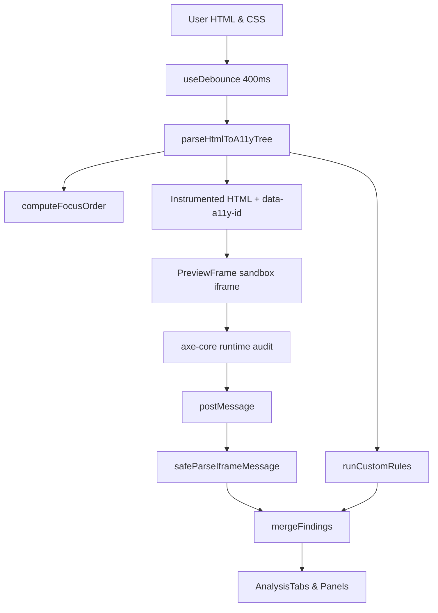

# Accessibility Playground Architecture

## Data Flow & Processing Pipeline

1. **Editor Input**: The user types HTML/CSS into CodeMirror 6 with autocompletion (roles, ARIA attributes, ID references, a11y snippets, Tailwind classes).
2. **Debounce**: Changes debounce at 400ms. If the input exceeds the 200KB limit, heavy AST parsing and automated analysis pause gracefully to protect responsiveness.
3. **AST Parsing & Instrumentation**: `parseHtmlToA11yTree` parses markup client-side into an `A11yNode` tree and assigns deterministic `data-a11y-id` tags.
4. **Host-Side Analysis**:
   - `runCustomRules`: Evaluates 13 modular accessibility rules host-side immediately.
   - `computeFocusOrder`: Analyzes natural tabindex, positive tabindexes, and interactive roles.
5. **Sandboxed Runtime Execution**:
   - `PreviewFrame` renders into an isolated `<iframe sandbox="allow-scripts">` without `allow-same-origin`.
   - `axe-core` executes locally from `public/axe.min.js`.
6. **Communication & Validation**:
   - Runtime results stream back via `window.postMessage`.
   - The host validates messages strictly using Zod (`HostMessageSchema`).
7. **Deduplication & Findings**:
   - `mergeFindings` deduplicates overlapping rules between `axe-core` and custom rules.
8. **Presentation & Error Isolation**:
   - `AnalysisTabs` lazy-loads heavy panels (`AriaExplorerPanel`, `AccessibleNamePanel`, `FocusOrderPanel`, `AnnouncementPanel`).
   - Each panel is guarded by a dedicated `<PanelBoundary>` to prevent panel errors from impacting the rest of the application.
