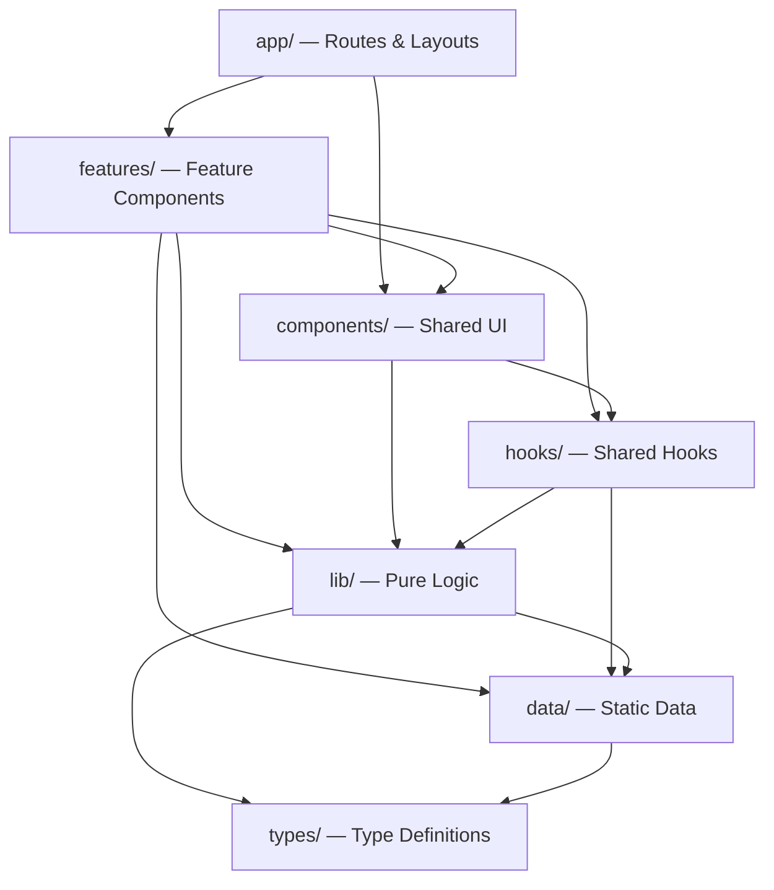
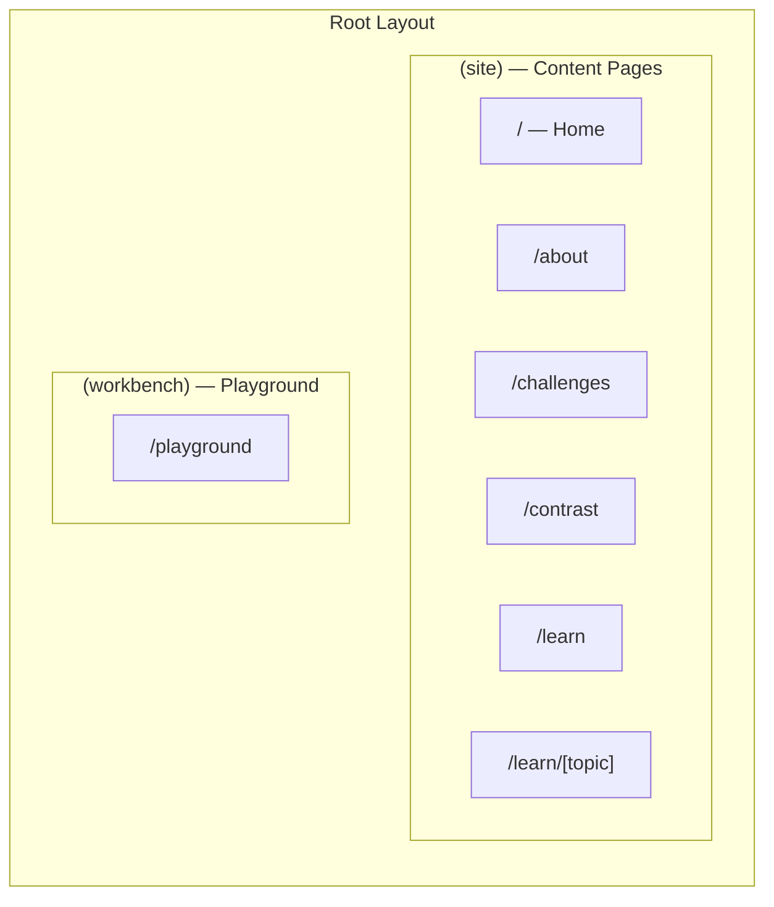
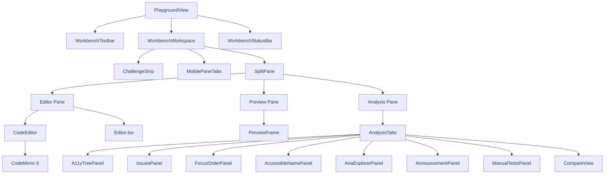
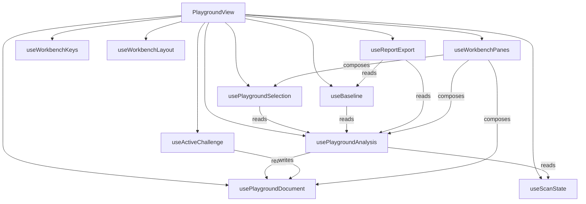
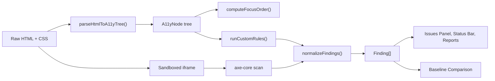
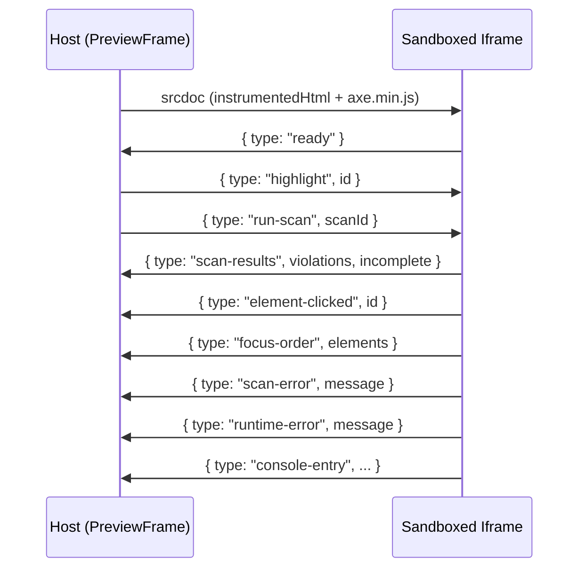
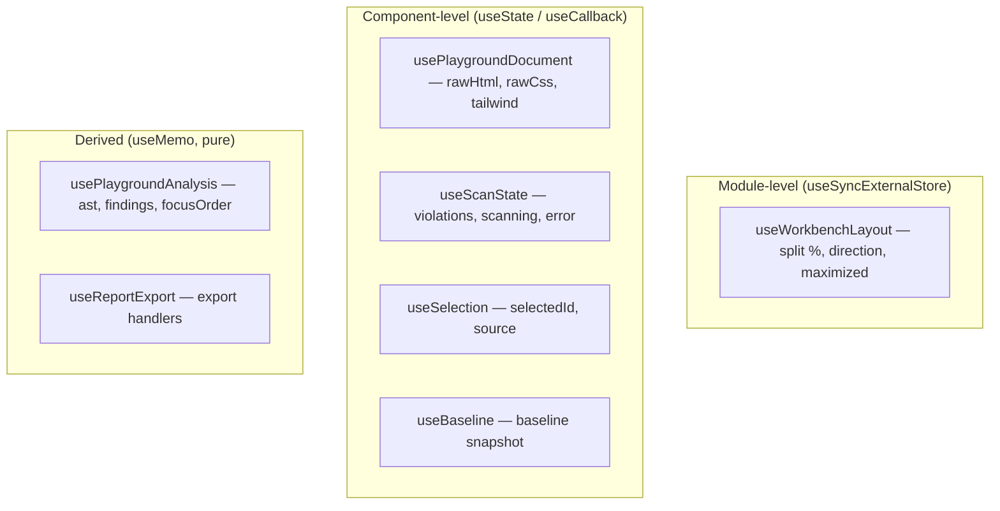
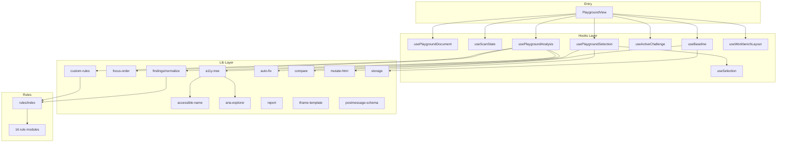

# Code Architecture — Accessibility Playground

> **Last updated:** November 2026 · **Stack:** Next.js 16.4 (App Router, Turbopack) · React 19.3 · TypeScript (strict) · Tailwind v4 · CodeMirror 6 · axe-core 4.14 · zod

---

## Table of Contents

1. [Project Overview](#1-project-overview)
2. [Directory Structure](#2-directory-structure)
3. [Layer Architecture](#3-layer-architecture)
4. [Routing & Layouts](#4-routing--layouts)
5. [Playground Workbench — Deep Dive](#5-playground-workbench--deep-dive)
6. [Analysis Pipeline](#6-analysis-pipeline)
7. [Custom Rules Engine](#7-custom-rules-engine)
8. [Iframe Sandbox & Message Bridge](#8-iframe-sandbox--message-bridge)
9. [Editor Subsystem](#9-editor-subsystem)
10. [State Management](#10-state-management)
11. [Data Layer](#11-data-layer)
12. [Security Model](#12-security-model)
13. [Testing Strategy](#13-testing-strategy)
14. [Design Tokens & Theming](#14-design-tokens--theming)
15. [Key Conventions](#15-key-conventions)
16. [How-To Guides](#16-how-to-guides)

---

## 1. Project Overview

Accessibility Playground is a **WCAG 2.2 AA inspector for web developers**. Users paste HTML/CSS into a live editor and watch its accessibility tree, ARIA state, focus order, and screen-reader announcement compute in real-time. A sandboxed iframe runs axe-core against the markup while 16 custom host-side rules provide instant feedback.

### Key Capabilities

| Feature                         | Description                                                                                      |
| ------------------------------- | ------------------------------------------------------------------------------------------------ |
| **Live A11y Tree**              | Parses user HTML into a computed accessibility tree with roles, names, and ARIA attributes       |
| **axe-core Integration**        | Runs axe-core inside a sandboxed iframe for WCAG violation detection                             |
| **16 Custom Rules**             | Host-side rules for patterns axe-core misses (e.g., `outline-removed`, `tab-pattern-incomplete`) |
| **Focus Order Visualiser**      | Computes and overlays the tab sequence on the live preview                                       |
| **Accessible Name Calculator**  | Step-by-step name computation breakdown per W3C accname spec                                     |
| **Screen-Reader Announcements** | Simulates what a screen reader would announce for selected elements                              |
| **ARIA Explorer**               | Validates ARIA attributes against the WAI-ARIA 1.2 spec                                          |
| **Baseline Comparison**         | Diff current findings against a saved baseline to track progress                                 |
| **Challenge Mode**              | Guided accessibility fix challenges with verification                                            |
| **Report Export**               | JSON / CSV / Markdown export of accessibility findings                                           |
| **Contrast Checker**            | Standalone WCAG contrast ratio calculator                                                        |
| **Learning Centre**             | 15 educational topics with good/bad examples linked to the playground                            |

### Codebase Stats

- **142 source files** · ~23,100 lines of TypeScript/TSX
- **35 unit test suites** (Vitest) · Playwright E2E
- **6 public routes** across 2 route groups

---

## 2. Directory Structure

```
accessibility-playground/
├── src/
│   ├── app/                    # Next.js App Router (routes, layouts, pages)
│   │   ├── (site)/             # Marketing/content pages with Header/Footer
│   │   │   ├── page.tsx        # Home page
│   │   │   ├── about/          # About page
│   │   │   ├── challenges/     # Challenge picker
│   │   │   ├── contrast/       # Standalone contrast checker
│   │   │   ├── learn/          # Learning centre index + [topic] pages
│   │   │   └── layout.tsx      # Site shell (Header + <main>)
│   │   ├── (workbench)/        # Chrome-less workbench shell
│   │   │   ├── playground/     # The main workbench route
│   │   │   └── layout.tsx      # Full-height layout with skip links
│   │   ├── layout.tsx          # Root layout (fonts, Providers, skip-to-main)
│   │   ├── globals.css         # Design tokens + global styles
│   │   ├── homepage.css        # Site-specific styles
│   │   ├── error.tsx           # Global error boundary
│   │   └── not-found.tsx       # 404 page
│   │
│   ├── components/             # Shared UI components
│   │   ├── ui/                 # Primitives (Badge, ButtonLink, CodeSnippet)
│   │   ├── workbench/          # Workbench-specific (SplitPane)
│   │   ├── Header.tsx          # Site header/nav
│   │   ├── Footer.tsx          # Site footer
│   │   ├── PanelBoundary.tsx   # Error boundary for analysis panels
│   │   ├── Providers.tsx       # Client-side context providers
│   │   └── WcagBadge.tsx       # WCAG level/criterion badge
│   │
│   ├── features/               # Feature-scoped components & hooks
│   │   ├── playground/         # The core workbench feature
│   │   │   ├── hooks/          # Extracted composition hooks
│   │   │   ├── editor/         # CodeMirror editor subsystem
│   │   │   └── *.tsx           # Workbench panels & UI components
│   │   ├── contrast/           # Contrast checker feature
│   │   └── home/               # Home page interactive demo
│   │
│   ├── hooks/                  # Shared React hooks
│   ├── lib/                    # Pure logic & utilities (no React)
│   │   ├── rules/              # Custom accessibility rule definitions
│   │   ├── findings/           # Finding normalization & dedup
│   │   └── *.ts                # Core algorithms & utilities
│   │
│   ├── data/                   # Static data (challenges, topics, WCAG, templates)
│   └── types/                  # TypeScript type definitions
│
├── tests/                      # Vitest unit test suites
├── e2e/                        # Playwright E2E tests
├── public/                     # Static assets (axe.min.js, icons)
└── scripts/                    # Build scripts (patch-accessly.js)
```

---

## 3. Layer Architecture

The codebase follows a strict **unidirectional dependency** model. Higher layers may import from lower layers, but never the reverse.



### Layer Rules

| Layer         | May Import From                                    | Never Imports From                           |
| ------------- | -------------------------------------------------- | -------------------------------------------- |
| `types/`      | (none)                                             | anything                                     |
| `data/`       | `types/`, `lib/` (for encoding only)               | `hooks/`, `features/`, `components/`, `app/` |
| `lib/`        | `types/`, `data/`                                  | `hooks/`, `features/`, `components/`, `app/` |
| `hooks/`      | `lib/`, `data/`, `types/`                          | `features/`, `components/`, `app/`           |
| `components/` | `hooks/`, `lib/`, `types/`                         | `features/`, `app/`                          |
| `features/`   | `components/`, `hooks/`, `lib/`, `data/`, `types/` | `app/`                                       |
| `app/`        | everything below it                                | (top level)                                  |

> **Enforced by:** `madge --circular` (no circular deps allowed) and code review.

---

## 4. Routing & Layouts

### Route Groups

The app uses two Next.js **route groups** with distinct layouts:



| Route Group   | Layout                                       | Chrome           | Rendering                                  |
| ------------- | -------------------------------------------- | ---------------- | ------------------------------------------ |
| `(site)`      | `Header` + `<main>` + `Footer`               | Full site nav    | Pages are Server Components where possible |
| `(workbench)` | Full-viewport `<main>` + skip link to editor | No header/footer | Client-side only (`ssr: false` boundary)   |

### SSR Boundary

The playground uses a **client-only boundary** in `PlaygroundClient.tsx`:

```
page.tsx (Server) → PlaygroundClient.tsx (dynamic import, ssr: false) → PlaygroundView.tsx (Client)
```

This prevents CodeMirror, axe-core, and DOM-dependent parsing logic from executing on the server.

---

## 5. Playground Workbench — Deep Dive

The workbench is the core feature. `PlaygroundView` is a **thin composition root** (~200 lines) that wires together extracted hooks and components.

### Component Hierarchy



### Hook Hierarchy

Each hook encapsulates one concern. `PlaygroundView` composes them:



### Hook Responsibilities

| Hook                     | File                             | Responsibility                                                                                         |
| ------------------------ | -------------------------------- | ------------------------------------------------------------------------------------------------------ |
| `usePlaygroundDocument`  | `hooks/usePlaygroundDocument.ts` | HTML/CSS state, debouncing, localStorage persistence, URL param restoration, template/reset actions    |
| `useScanState`           | `hooks/useScanState.ts`          | axe-core scan lifecycle (violations, incomplete, scanning flag, error)                                 |
| `usePlaygroundAnalysis`  | `features/playground/hooks/`     | Pure derivations: AST parsing, focus order, custom rules, finding normalization, violation counts      |
| `usePlaygroundSelection` | `features/playground/hooks/`     | Selection sync across editor / preview / tree, reveal requests, focus simulation, auto-fix application |
| `useActiveChallenge`     | `features/playground/hooks/`     | Challenge mode lifecycle, solution loading, starter reset                                              |
| `useBaseline`            | `hooks/useBaseline.ts`           | Baseline snapshot save/load (sessionStorage), finding comparison via `lib/compare.ts`                  |
| `useReportExport`        | `features/playground/hooks/`     | JSON/CSV/Markdown download generation, clipboard copy with toast                                       |
| `useWorkbenchKeys`       | `features/playground/hooks/`     | Global keyboard shortcuts (Esc to exit maximize, F6 pane cycling)                                      |
| `useWorkbenchLayout`     | `hooks/useWorkbenchLayout.ts`    | 3-pane split percentages, direction, maximized state, presets (uses `useSyncExternalStore`)            |
| `useWorkbenchPanes`      | `features/playground/hooks/`     | Assembles the 3 pane React nodes (editor, preview, analysis) from all other state                      |

---

## 6. Analysis Pipeline

The analysis pipeline transforms raw HTML into structured accessibility findings through a multi-stage pipeline:



### Stage Details

| Stage             | Module                      | Input                       | Output                                                                |
| ----------------- | --------------------------- | --------------------------- | --------------------------------------------------------------------- |
| **Parse**         | `lib/a11y-tree.ts`          | `debouncedHtml`             | `A11yNode` tree + `instrumentedHtml` (with `data-a11y-id` attributes) |
| **Focus Order**   | `lib/focus-order.ts`        | `A11yNode`                  | Ordered list of focusable elements with tab indices                   |
| **Custom Rules**  | `lib/custom-rules.ts`       | `A11yNode` + CSS + HTML     | `AxeFinding[]` from 16 host-side rules                                |
| **axe-core Scan** | iframe runtime              | `instrumentedHtml`          | `AxeFinding[]` violations + incomplete                                |
| **Normalise**     | `lib/findings/normalize.ts` | Custom + axe findings       | `Finding[]` — deduplicated, fingerprinted, WCAG-mapped                |
| **Compare**       | `lib/compare.ts`            | Current + baseline findings | `CompareResult` (new, fixed, persisting)                              |

### Key Types

```typescript
// The unified finding type (single source of truth)
interface Finding {
  fingerprint: string; // Stable hash: ruleId + target + normalized HTML
  ruleId: string;
  engine: "axe-core" | "playground";
  status: "violation" | "needs-review" | "manual-required";
  confidence: "high" | "medium" | "low";
  impact: "critical" | "serious" | "moderate" | "minor";
  wcag: WcagRef[];
  help: string;
  description: string;
  helpUrl: string;
  nodes: AxeFindingNode[];
  fix?: string; // Auto-fix HTML mutation
}

// Accessibility tree node
interface A11yNode {
  id: string;
  tagName: string;
  role: string; // Computed ARIA role
  implicitRole: string; // Browser-default role
  explicitRole?: string; // Author-specified role
  accessibleName: string; // Computed via accname spec
  accessibleNameSource: string;
  ariaAttributes: Record<string, string>;
  children: A11yNode[];
  sourceRange?: [number, number]; // Maps back to editor position
}
```

---

## 7. Custom Rules Engine

### Architecture

Rules are self-contained objects implementing the `Rule` interface:

```typescript
interface Rule {
  id: string;
  impact: AxeImpactLevel;
  wcag: readonly string[]; // WCAG SC references
  help: string;
  confidence?: "high" | "medium" | "low";
  equivalentAxeIds?: readonly string[]; // For dedup with axe-core
  checkNode?(node: A11yNode, ctx: RuleContext): AxeFinding[];
  checkEnd?(ctx: RuleContext): AxeFinding[];
}
```

- **`checkNode`** — invoked per-node during tree traversal (e.g., `img-missing-alt`)
- **`checkEnd`** — invoked once after traversal for cross-node checks (e.g., `heading-order`, `duplicate-id`)

### Rule Registry (16 rules)

| Rule ID                          | Impact   | WCAG  | Pattern                                                |
| -------------------------------- | -------- | ----- | ------------------------------------------------------ |
| `click-on-non-interactive`       | serious  | 4.1.2 | `<div onclick>` without role/tabindex                  |
| `interactive-role-not-focusable` | serious  | 4.1.2 | `role="button"` without `tabIndex`                     |
| `link-as-button`                 | moderate | 4.1.2 | `<a href="#">` used as a button                        |
| `input-placeholder-only`         | serious  | 1.3.1 | Input with placeholder but no label                    |
| `input-no-label`                 | critical | 1.3.1 | Input with no accessible name                          |
| `img-missing-alt`                | critical | 1.1.1 | `` without `alt` attribute                        |
| `empty-interactive-name`         | serious  | 4.1.2 | Button/link with empty accessible name                 |
| `positive-tabindex`              | moderate | 2.4.3 | `tabindex > 0`                                         |
| `aria-hidden-focusable`          | serious  | 4.1.2 | `aria-hidden="true"` on focusable element              |
| `heading-order`                  | moderate | 1.3.1 | Skipped heading levels                                 |
| `dialog-no-name`                 | serious  | 4.1.2 | `<dialog>` without accessible name                     |
| `tab-pattern-incomplete`         | moderate | 2.1.1 | Tablist without roving tabindex                        |
| `duplicate-id`                   | minor    | 4.1.1 | Duplicate `id` attributes                              |
| `aria-broken-reference`          | serious  | 1.3.1 | `aria-labelledby`/`describedby` pointing to missing ID |
| `invalid-aria`                   | serious  | 4.1.2 | Invalid ARIA attribute values                          |
| `outline-removed`                | serious  | 2.4.7 | CSS `outline: none` without replacement                |

### Adding a New Rule

1. Create `src/lib/rules/my-rule.ts` implementing the `Rule` interface
2. Register it in `src/lib/rules/index.ts` → `RULES` array
3. Add knowledge entry in `src/data/rule-knowledge.ts` for the FindingDetail panel
4. Add test fixtures in `tests/custom-rules.test.ts`
5. If it has an axe-core equivalent, set `equivalentAxeIds` for deduplication

---

## 8. Iframe Sandbox & Message Bridge

The preview runs user HTML in a **fully sandboxed iframe** (`sandbox="allow-scripts"` — no `allow-same-origin`). Communication uses `postMessage` with strict validation.



### Security Constraints

| Control               | Implementation                                                                        |
| --------------------- | ------------------------------------------------------------------------------------- |
| **Sandbox**           | `sandbox="allow-scripts"` — no origin, no forms, no popups                            |
| **Origin check**      | `event.source === iframeRef.current.contentWindow` on every message                   |
| **Schema validation** | Every inbound message parsed through zod schemas (`lib/postmessage-schema.ts`)        |
| **No eval**           | No `dangerouslySetInnerHTML`, `eval`, or `new Function` in host code                  |
| **Instrumented HTML** | Host injects `data-a11y-id` attributes for element identification (never user-facing) |

---

## 9. Editor Subsystem

### Component Structure

```
Editor.tsx (toolbar, language tabs, settings)
└── CodeEditor.tsx (CodeMirror wrapper)
    ├── createEditor.ts — EditorView factory
    ├── compartments.ts — Reconfigurable compartment definitions
    ├── useCompartment.ts — Hook for reactive compartment updates
    └── extensions/
        ├── theme.ts — Dark/light theme
        ├── diagnostics.ts — Inline lint markers from findings
        ├── reveal.ts — Scroll-to & highlight selected node
        ├── external-value.ts — External document sync
        ├── keymaps.ts — Custom keybindings
        ├── format.ts — Prettier-based formatting
        ├── status.ts — Cursor position / selection tracking
        └── completions/
            ├── aria.ts — ARIA attribute completions
            ├── a11y-snippets.ts — Accessibility pattern snippets
            ├── css-a11y.ts — CSS accessibility completions
            ├── id-refs.ts — ID cross-reference completions
            └── tailwind.ts — Tailwind class completions
```

### Key Pattern: `useCompartment`

Instead of one `useEffect` per editor setting, compartment updates are unified through `useCompartment(viewRef, compartment, extension)`:

```typescript
// Before: 13 separate useEffects
useEffect(() => {
  view.dispatch({ effects: fontSizeComp.reconfigure(fontSize(...)) });
}, [fontSize]);

// After: one hook per compartment, zero eslint-disable
useCompartment(viewRef, fontSizeComp, fontSize(settings.fontSize));
```

---

## 10. State Management

The app uses **no global state library**. State is managed through composition of React hooks at the `PlaygroundView` level.

### State Ownership



| Pattern                    | Usage                            | Example                                          |
| -------------------------- | -------------------------------- | ------------------------------------------------ |
| **`useState`**             | Local component state            | Scan results, selected tab, mobile pane          |
| **`useSyncExternalStore`** | Module-level singleton state     | `useWorkbenchLayout` (persisted to localStorage) |
| **`useMemo`**              | Expensive derivations            | AST parsing, focus order, finding normalization  |
| **`useCallback`**          | Stable handler references        | Template selection, scan triggers                |
| **`useLatest`**            | Ref-based callback stabilization | Editor event handlers (avoids stale closures)    |
| **Props**                  | Parent to child data flow        | All data flows down from `PlaygroundView`        |

### Persistence

All persistence goes through `lib/storage.ts`:

| Key                            | Storage          | Schema           | Content                                 |
| ------------------------------ | ---------------- | ---------------- | --------------------------------------- |
| `a11y-playground:html`         | `localStorage`   | string           | User's HTML document                    |
| `a11y-playground:css`          | `localStorage`   | string           | User's CSS                              |
| `a11y-playground:tailwind`     | `localStorage`   | `"true"/"false"` | Tailwind CDN toggle                     |
| `a11y-playground:layout`       | `localStorage`   | JSON (zod)       | Split percentages, direction, maximized |
| `a11y-playground:manual-tests` | `localStorage`   | JSON (zod)       | Manual test checklist state             |
| `ap_baseline_v1_<id>`          | `sessionStorage` | JSON (zod)       | Baseline finding snapshots              |

---

## 11. Data Layer

Static data lives in `src/data/` and is imported directly (no API calls, no database).

| File                 | Size       | Content                                                 | Consumers                          |
| -------------------- | ---------- | ------------------------------------------------------- | ---------------------------------- |
| `challenges.ts`      | 1005 lines | 10 interactive challenges with starter/solution HTML    | Challenge mode, `/challenges` page |
| `learn-topics.ts`    | 1005 lines | 15 educational topics with examples                     | `/learn`, `/learn/[topic]` pages   |
| `rule-knowledge.ts`  | 1177 lines | Explanations, why-it-matters, fix instructions per rule | `FindingDetail` panel              |
| `wcag.ts`            | 574 lines  | WCAG 2.2 criteria database                              | Finding normalization, badges      |
| `templates.ts`       | ~200 lines | Starter HTML templates                                  | Template picker, defaults          |
| `editor-snippets.ts` | ~150 lines | Code snippet library                                    | Snippets menu                      |
| `manual-tests.ts`    | ~200 lines | Manual testing checklists                               | Manual tests panel                 |

---

## 12. Security Model

### Threat Model

The app processes arbitrary user HTML. The security boundary ensures user code cannot:

- Access the host page DOM or JavaScript context
- Exfiltrate data from `localStorage` or `sessionStorage`
- Navigate the host page or open popups
- Execute code in the host origin

### Controls

1. **Iframe sandbox** — `sandbox="allow-scripts"` (no `allow-same-origin`, no `allow-forms`, no `allow-popups`)
2. **Message validation** — All `postMessage` payloads validated with zod schemas before processing
3. **Source verification** — `event.source === iframe.contentWindow` check on every message
4. **No dynamic code execution** — No `eval`, `new Function`, or `dangerouslySetInnerHTML` in host
5. **Content isolation** — User HTML rendered via `srcdoc`, never injected into host DOM
6. **axe-core isolation** — axe runs inside the sandbox, results serialized via `postMessage`

---

## 13. Testing Strategy

### Unit Tests (Vitest)

35 test suites covering:

| Category              | Suites                                                                   | Key Coverage                                  |
| --------------------- | ------------------------------------------------------------------------ | --------------------------------------------- |
| **Core algorithms**   | `a11y-tree`, `accessible-name`, `focus-order`, `contrast`, `diff`        | AST parsing, name computation, tab order      |
| **Rules engine**      | `custom-rules`, `rules-table`                                            | All 16 rules with fixtures                    |
| **Findings pipeline** | `findings-normalize`, `merge-findings`, `compare`                        | Dedup, fingerprinting, baseline diff          |
| **Data integrity**    | `challenges`, `templates-audit`, `learn`, `wcag`, `rule-knowledge`       | Challenge solutions verify, template validity |
| **Utilities**         | `storage`, `snippet-share`, `postmessage-schema`, `iframe-template`      | Persistence, sharing, message schemas         |
| **UI hooks**          | `playground-analysis`, `workbench-keys`, `report-export`, `workbench-ui` | Hook behaviour, component rendering           |

### E2E Tests (Playwright)

- Full playground flow: type, scan, select, inspect
- Keyboard navigation: F6 pane cycling, Esc maximize exit
- Challenge mode: load, fix, verify
- axe-core accessibility audit on all routes

### Quality Gate

```bash
npm run check     # ESLint (--max-warnings 0) + TypeScript (--noEmit) + Prettier
npm test          # Vitest unit tests
npm run test:e2e  # Playwright E2E
npm run build     # Next.js production build
npm run deadcode  # Knip (unused exports/files/deps)
npm run circular  # Madge (circular dependency detection)
```

All gates must pass. Pre-commit hooks (Husky + lint-staged) enforce `eslint --fix` and `prettier --write` on staged files.

---

## 14. Design Tokens & Theming

The app uses **CSS custom properties** defined in `globals.css`, referenced via Tailwind's `var()` syntax:

```css
/* Token categories */
--color-canvas          /* Page background */
--color-surface         /* Card/panel background */
--color-text-primary    /* Primary text */
--color-text-secondary  /* Muted text */
--color-focus-ring      /* Focus indicator */
--color-border          /* Default borders */
--color-accent          /* Primary accent */
--color-danger          /* Error/violation */
--color-success         /* Pass/fixed */
--color-warning         /* Needs review */
```

**Fonts** are loaded via `next/font/google`:

| Variable         | Font           | Usage                      |
| ---------------- | -------------- | -------------------------- |
| `--font-display` | Space Grotesk  | Headings, hero text        |
| `--font-sans`    | Public Sans    | Body text, UI labels       |
| `--font-mono`    | JetBrains Mono | Code editor, code snippets |

---

## 15. Key Conventions

### Naming

| Convention             | Example                                              |
| ---------------------- | ---------------------------------------------------- |
| **Feature components** | `*Panel.tsx`, `*Strip.tsx`, `*View.tsx`              |
| **Hooks**              | `use*.ts` — one concern per hook                     |
| **Pure logic**         | `lib/*.ts` — no React imports                        |
| **Types**              | `types/*.ts` — shared interfaces, exported as `type` |
| **Tests**              | `tests/<module-name>.test.ts`                        |

### Code Standards

- **`strict` TypeScript** with `noUncheckedIndexedAccess` — no `any`, no `@ts-ignore`
- **Zero ESLint warnings** — `--max-warnings 0`
- **No inline `eslint-disable`** — file-scoped overrides in `eslint.config.mjs` when justified
- **`readonly` arrays/objects** in interfaces — immutable data flow
- **`React.useMemo`** for AST/findings derivations — never for cheap primitives
- **Error boundaries** — `PanelBoundary` wraps every analysis panel; route-level `error.tsx`

### Import Aliases

```json
{
  "@/*": ["./src/*"]
}
```

All imports use the `@/` alias. Relative imports used only within the same feature directory.

---

## 16. How-To Guides

### Adding a New Analysis Panel

1. Create `src/features/playground/MyPanel.tsx`
2. Wrap exports with `React.lazy()` for code splitting
3. Add a tab entry in `AnalysisTabs.tsx`
4. Wrap with `<PanelBoundary>` for error isolation
5. Pass required data from `useWorkbenchPanes`

### Adding a New Challenge

1. Add a `Challenge` object to `src/data/challenges.ts`:
   - `startHtml` with deliberate violations
   - `expected` array of `{ ruleId, wcag }` tuples
   - `solutionHtml` that fixes all issues
   - `verify.ruleIdsMustBeAbsent` for automated verification
2. The challenge test suite (`tests/challenges.test.ts`) auto-validates:
   - Starter HTML triggers all expected rules
   - Solution HTML clears all `ruleIdsMustBeAbsent` rules

### Adding a New Learning Topic

1. Add a `LearnTopic` to `src/data/learn-topics.ts`
2. Provide `badExample` and `goodExample` with HTML (linked to playground via `encodeSnippet`)
3. Map `relatedRuleIds` and optionally `challengeId`
4. The topic page is auto-generated via `generateStaticParams` in `/learn/[topic]`

### Adding a New Custom Rule

1. Create `src/lib/rules/my-rule.ts`:

```typescript
import type { Rule } from "./types";

export const myRule: Rule = {
  id: "my-rule-id",
  impact: "serious",
  wcag: ["4.1.2"],
  help: "Short help text",
  equivalentAxeIds: ["axe-rule-id"], // if applicable
  checkNode(node, ctx) {
    // Return AxeFinding[] for violations
    return [];
  },
};
```

2. Register in `src/lib/rules/index.ts`
3. Add knowledge in `src/data/rule-knowledge.ts`
4. Write test fixtures in `tests/custom-rules.test.ts`

### Modifying the Editor

- **New completion source** — Add to `src/features/playground/editor/extensions/completions/`
- **New keybinding** — Add to `extensions/keymaps.ts`
- **New compartment** — Define in `compartments.ts`, use via `useCompartment` hook
- **New language mode** — Add CodeMirror language package, register in `createEditor.ts`

---

## Appendix: Dependency Graph (Key Modules)


