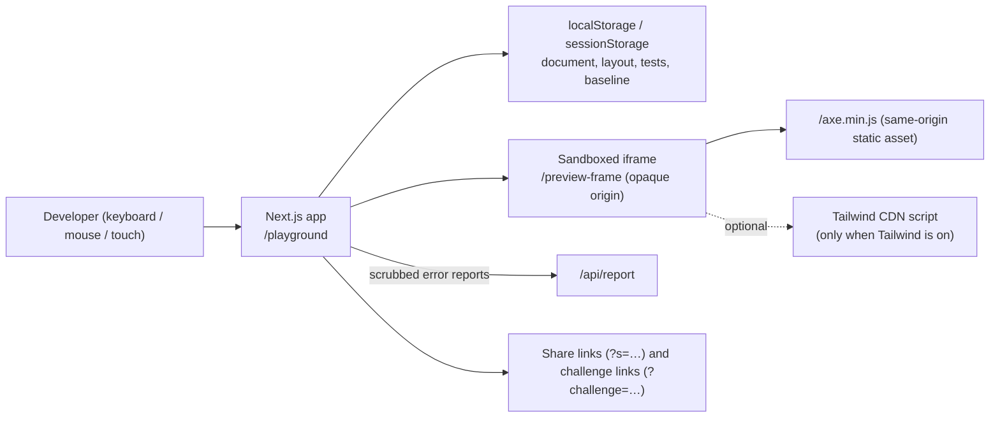
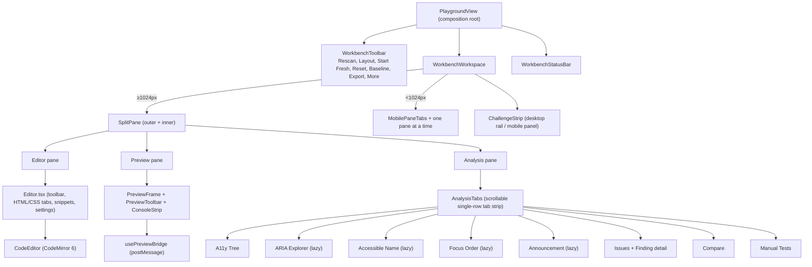
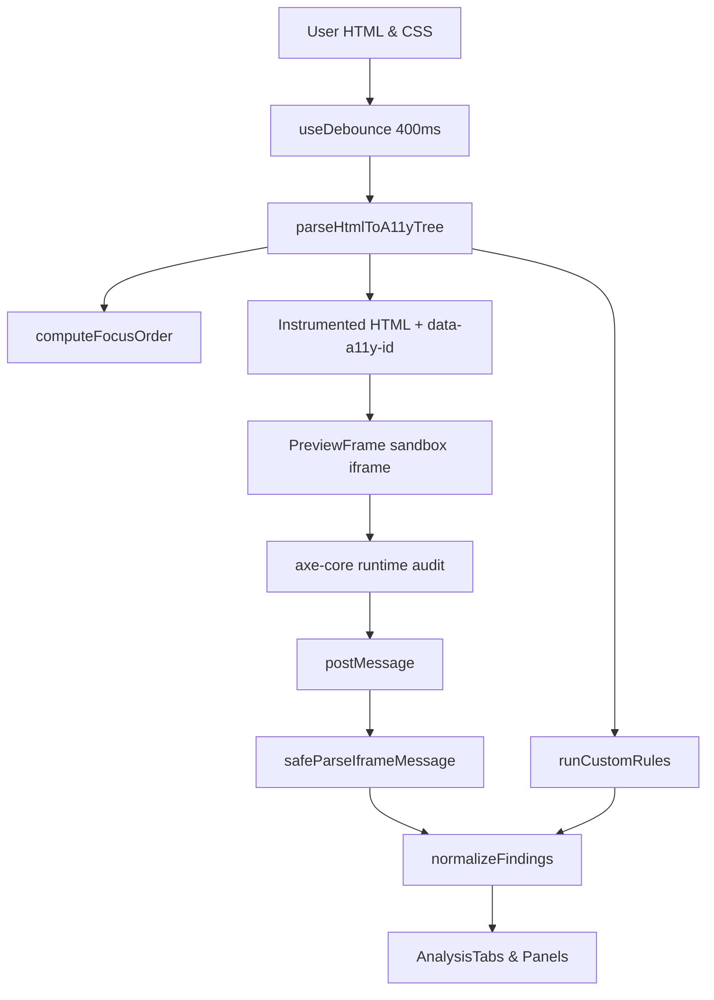
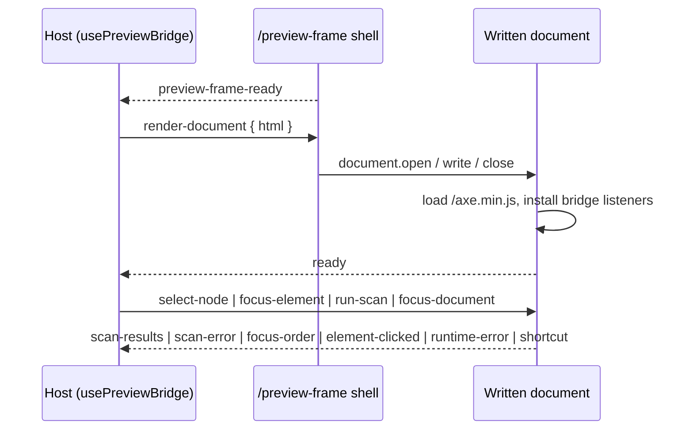
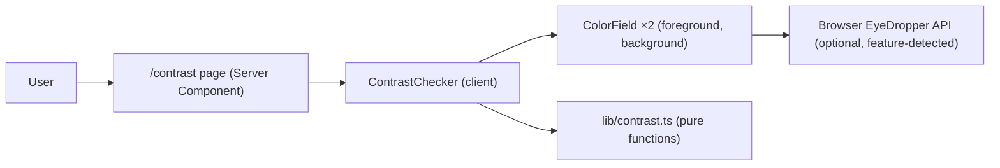
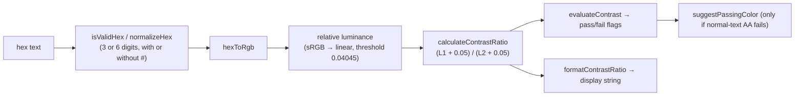

# Architecture — Accessibility Playground

## 1. Playground HLD

### 1.1 Purpose

A WCAG 2.2 AA inspector for web developers. The user writes HTML/CSS in a live editor and sees, in real time: the rendered page, the computed accessibility tree, ARIA state, focus order, accessible-name computation, a screen-reader announcement, automated findings (axe-core + 16 custom rules), a baseline diff and manual-test checklists. Everything runs in the browser; there is no database and no accounts.

### 1.2 System context



External calls: none for analysis. Optional third-party request: the Tailwind CDN script, only inside the preview iframe and only when the user enables Tailwind.

### 1.3 Routing and rendering boundary

| Route            | Type                                     | Notes                                                                                       |
| ---------------- | ---------------------------------------- | ------------------------------------------------------------------------------------------- |
| `/playground`    | `(workbench)` group, full-viewport shell | Server page → `PlaygroundClient` (dynamic import, `ssr: false`) → `PlaygroundView` (client) |
| `/preview-frame` | Route handler, static HTML shell         | Loaded as the iframe `src`; own relaxed CSP; receives the document by `postMessage`         |
| `/api/report`    | Route handler (POST)                     | Validates and logs scrubbed error reports                                                   |
| `/api/health`    | Route handler (GET)                      | Health check                                                                                |

The client-only boundary keeps CodeMirror, DOM parsing and iframe logic off the server. The workbench shell is `h-dvh` with clipped overflow; only inner panels scroll.

### 1.4 Component architecture



Every analysis panel is wrapped in `PanelBoundary` so one failing panel cannot take down the workbench. Heavy panels are code-split and load only when their tab is selected.

### 1.5 State and hook composition

There is no global state library. `PlaygroundView` composes single-purpose hooks and passes data down as props.

| Hook                     | Owns                                                                                                                                                                            |
| ------------------------ | ------------------------------------------------------------------------------------------------------------------------------------------------------------------------------- |
| `usePlaygroundDocument`  | HTML/CSS text, Tailwind toggle, debounced copies, persistence, URL restore (`?s=`, `?challenge=`), Start Fresh / Reset (`DEFAULT_DOCUMENT`), the `externalEdit` request channel |
| `useScanState`           | axe results, `scanId`, `isScanning`, `scanError`                                                                                                                                |
| `usePlaygroundAnalysis`  | Pure derivations: AST, instrumented HTML, focus order, custom-rule findings, normalized `Finding[]`, engine status                                                              |
| `usePlaygroundSelection` | One selected node shared by editor, preview, tree and inspectors; reveal requests; focus simulation; auto-fix and ARIA edits                                                    |
| `useActiveChallenge`     | Lazy challenge loading, status (`ready`/`error`), fallback to the default document                                                                                              |
| `useBaseline`            | Baseline snapshot per document id (sessionStorage), comparison via `lib/compare.ts`                                                                                             |
| `useReportExport`        | JSON / CSV / Markdown export and clipboard copy                                                                                                                                 |
| `useWorkbenchLayout`     | Split percentages, direction, maximized pane (`useSyncExternalStore` + localStorage)                                                                                            |
| `useWorkbenchKeys`       | Global shortcuts: F6 / Shift+F6 pane cycling, Ctrl/Cmd+Enter rescan, Esc to restore a maximized pane                                                                            |
| `useWorkbenchPanes`      | Builds the three pane nodes from the state above                                                                                                                                |
| `useManualTests`         | Manual checklist status per document id (localStorage + zod)                                                                                                                    |

**Document identity.** `documentId` is `"default"`, a challenge id, or a share id. Baselines and manual-test results are stored per `documentId`.

### 1.6 Data flow: typing to findings

```mermaid
sequenceDiagram
    participant Ed as CodeEditor
    participant Doc as usePlaygroundDocument
    participant An as usePlaygroundAnalysis
    participant Pv as PreviewFrame / bridge
    participant If as Sandboxed iframe (axe)
    participant UI as Issues / Tree / Status

    Ed->>Doc: onChange(text)  [typing; editor is source of truth]
    Doc->>Doc: debounce, persist
    Doc->>An: debouncedHtml / debouncedCss
    An->>An: parse → AST → focus order → custom rules
    An->>Pv: instrumentedHtml (data-a11y-id)
    Pv->>If: render-document (postMessage)
    Pv->>If: run-scan { scanId }
    If-->>Pv: scan-results | scan-error
    Pv->>An: axe violations / incomplete / error
    An->>An: normalizeFindings(custom + axe)
    An->>UI: Finding[], counts, engine status
```

Rules of the data flow:

- **Typing** flows editor → parent state only.
- **Programmatic changes** (snippet load, challenge load, Start Fresh, Reset, ARIA edit, auto-fix) flow parent → editor through a single `externalEdit` request `{ id, kind: "replace" | "patch", text }`, applied once per `id` and annotated so it never echoes back.
- A scan is a request with a `scanId`; stale results are ignored. Scan requests made before the frame is ready are queued and flushed when the frame reports ready.

#### Pipeline overview



##### Data flow and processing pipeline

1. **Editor input.** The user types HTML/CSS into CodeMirror 6 with autocompletion (roles, ARIA attributes, ID references, a11y snippets, Tailwind classes).
2. **Debounce.** Changes are debounced at 400 ms. If the input exceeds the 200 KB limit, heavy AST parsing and automated analysis pause gracefully to protect responsiveness, and the UI says so.
3. **AST parsing and instrumentation.** `parseHtmlToA11yTree` parses the markup client-side into an `A11yNode` tree and assigns deterministic `data-a11y-id` attributes.
4. **Host-side analysis.**
   - `runCustomRules` evaluates the 16 modular accessibility rules immediately, with no iframe needed.
   - `computeFocusOrder` analyzes natural tab order, positive `tabindex` values and interactive roles.
5. **Sandboxed runtime execution.**
   - `PreviewFrame` renders the document in an isolated `<iframe sandbox="allow-scripts">` (no `allow-same-origin`), loaded from `/preview-frame`.
   - `axe-core` runs locally from `public/axe.min.js`.
6. **Communication and validation.**
   - Runtime results return through `window.postMessage`.
   - The host checks `event.source` and validates every inbound message with Zod (`safeParseIframeMessage`); outbound host messages follow `HostMessageSchema`.
7. **Deduplication and findings.**
   - `normalizeFindings` merges custom-rule and axe results into one `Finding[]`: it deduplicates overlapping rules (via `equivalentAxeIds`), fingerprints each finding and maps it to WCAG.
8. **Presentation and error isolation.**
   - `AnalysisTabs` lazy-loads the heavy panels (`AriaExplorerPanel`, `AccessibleNamePanel`, `FocusOrderPanel`, `AnnouncementPanel`).
   - Each panel is wrapped in its own `<PanelBoundary>`, so a panel error cannot affect the rest of the application.

### 1.7 Analysis pipeline

| Stage        | Module                                                                            | Output                                                                                                                                                     |
| ------------ | --------------------------------------------------------------------------------- | ---------------------------------------------------------------------------------------------------------------------------------------------------------- |
| Parse        | `lib/a11y-tree.ts`                                                                | `A11yNode` tree + instrumented HTML (`data-a11y-id`), source ranges mapped back to the editor                                                              |
| Derivations  | `lib/focus-order.ts`, `accessible-name.ts`, `announcement.ts`, `aria-explorer.ts` | Focus sequence, name computation steps, announcement text, ARIA validity                                                                                   |
| Custom rules | `lib/custom-rules.ts`, `lib/rules/*`                                              | Host-side findings from 16 rules (`checkNode` per node, `checkEnd` for cross-node checks)                                                                  |
| axe scan     | iframe + `/axe.min.js`                                                            | Violations and "incomplete" results                                                                                                                        |
| Normalize    | `lib/findings/normalize.ts`                                                       | Unified `Finding[]`: stable fingerprint, status (`violation` / `needs-review` / `manual-required`), confidence, WCAG mapping, dedup via `equivalentAxeIds` |
| Compare      | `lib/compare.ts`                                                                  | New / resolved / persisting vs. baseline                                                                                                                   |
| Report       | `lib/report.ts`                                                                   | JSON / CSV / Markdown, including which engines ran                                                                                                         |

**Engine independence.** Custom rules need only the parsed tree; axe needs the iframe. If axe cannot load, the app enters a **degraded mode**: a non-blocking banner with Retry, custom-rule findings still listed, counts derived from the same `Finding[]` everywhere, exports and baseline comparison labeled with the missing engine, and challenge verification refusing to pass or fail on an incomplete scan.

### 1.8 Preview sandbox and message bridge

The user's document runs in `<iframe src="/preview-frame" sandbox="allow-scripts">`. There is **no** `allow-same-origin`, so the frame has an opaque origin and cannot touch the host page, cookies or storage.



| Control           | Implementation                                                                                                                                                                                                                                                      |
| ----------------- | ------------------------------------------------------------------------------------------------------------------------------------------------------------------------------------------------------------------------------------------------------------------- |
| Isolation         | `sandbox="allow-scripts"` only                                                                                                                                                                                                                                      |
| Source check      | `event.source === iframe.contentWindow` before any message is read                                                                                                                                                                                                  |
| Validation        | Every inbound message parsed by zod schemas in `lib/postmessage-schema.ts`                                                                                                                                                                                          |
| Forwarded keys    | Inside the frame, F6 / Ctrl+Enter / Esc are forwarded as validated `shortcut` messages so keyboard users never get trapped                                                                                                                                          |
| Headers           | `/preview-frame` has its own CSP (inline bridge, `'self'` for axe, Tailwind host only when needed); site routes keep a strict CSP. `/axe.min.js` is served with `Cross-Origin-Resource-Policy: cross-origin` because the opaque-origin frame counts as cross-origin |
| Tailwind          | Optional script injected into the preview only; reset (Preflight) is off by default so plain-CSS pages render identically; user CSS is emitted after Tailwind's output                                                                                              |
| No host injection | No `dangerouslySetInnerHTML`, `eval` or `new Function` in host code                                                                                                                                                                                                 |

### 1.9 Editor subsystem

`Editor.tsx` provides the toolbar, HTML/CSS tabs, snippets and settings; `CodeEditor.tsx` wraps CodeMirror 6.

- Extension array is created once; everything dynamic lives in **Compartments** updated through `useCompartment` (language, tab size, wrapping, font size, autocomplete, line numbers, ARIA label, indent-with-tab, lint).
- Callbacks reach the editor through a stable event bus plus a latest-ref, so listeners are never recreated.
- Extensions: theme, diagnostics from findings, reveal (scroll and highlight the selected node), external-value sync (minimal diff), keymaps (VS Code-style, Ctrl/Cmd+Enter rescan), Prettier formatting, status (cursor/selection), completions (ARIA, a11y snippets, CSS a11y, id references, Tailwind).
- The active line uses a translucent tint so the selection layer stays visible; keyboard users leave the editor with Esc then Tab.

### 1.10 Layout, keyboard model and scrolling

- **≥ 1024 px:** nested `SplitPane`s (editor / preview / analysis) with keyboard-operable separators and persisted sizes; any pane can be maximized.
- **< 1024 px:** one pane at a time through `MobilePaneTabs`; the challenge panel is available here too.
- **Analysis tabs:** one row, horizontal strip scrolled by code scoped to the strip only; the maximize button sits outside the strip; short labels at narrow widths while the full name stays in the accessible name.
- **Shortcuts:** F6 / Shift+F6 cycle editor → preview → analysis (including from inside the preview), Ctrl/Cmd+Enter rescans from anywhere exactly once, Esc restores a maximized pane.
- **Overflow containment:** workbench containers are positioned and clipped (`overflow-clip`), so neither `scrollIntoView`, focus, nor absolutely positioned hidden text can scroll or extend the page; a small guard resets stray scroll on the main element.
- **Scrollbars:** thin, themed scrollbars for fine pointers; touch devices keep native overlay bars; forced-colors mode falls back to native.

### 1.11 Persistence

All access goes through `lib/storage.ts` (guarded, never throws, zod-validated JSON).

| Key                             | Storage        | Content                                 |
| ------------------------------- | -------------- | --------------------------------------- |
| `a11y-playground:html` / `:css` | localStorage   | The user's document                     |
| `a11y-playground:tailwind`      | localStorage   | Tailwind toggle                         |
| `a11y-playground:layout`        | localStorage   | Split sizes, direction, maximized pane  |
| `a11y-playground:manual-tests`  | localStorage   | Manual checklist state per document id  |
| challenge progress              | localStorage   | Per-challenge progress and hint reveals |
| `ap_baseline_v1_<id>`           | sessionStorage | Baseline snapshot per document id       |

### 1.12 Data modules (static, imported directly)

`data/default-document.ts` (first-load document), `challenges.ts` + `challenges/` (lazy-loaded starters and solutions), `learn-topics.ts`, `rule-knowledge.ts` (explanations and fixes per rule), `wcag.ts` (criteria database), `manual-tests.ts`, `editor-snippets.ts`.

### 1.13 Security and privacy summary

- User code only ever executes inside the opaque-origin sandbox; host and iframe communicate through validated messages.
- Analysis runs locally; the only optional third-party request is the Tailwind script in the preview.
- Error reporting (`reportError` → `/api/report`) sends a scrubbed payload only: error name and truncated message, route without query, version, whitelisted context keys. It never sends the document, share payloads, URL hashes or storage contents, and it is rate-limited and de-duplicated.
- Site routes use a strict CSP and standard security headers; share-link pages are marked non-indexable.

### 1.14 Quality gates

`npm run check` (ESLint with zero warnings, `tsc --noEmit`, Prettier) · `npm test` (Vitest) · `npm run build` · `npm run test:e2e` (Playwright, desktop and mobile projects, including axe checks, responsive no-overflow checks, preview/CSP/degraded-mode checks) · `npm run circular` (madge) · `npm audit --omit=dev --audit-level=high`. Layering is enforced: `types` ← `data`/`lib` ← `hooks` ← `components` ← `features` ← `app`, with no cycles.

### 1.15 Extension points

| To add…           | Do this                                                                                                                                       |
| ----------------- | --------------------------------------------------------------------------------------------------------------------------------------------- |
| A custom rule     | Implement `Rule` in `lib/rules/`, register it in `rules/index.ts`, add knowledge in `data/rule-knowledge.ts`, add fixtures to the rules tests |
| An analysis panel | Create the panel, lazy-load it, add a tab in `AnalysisTabs`, wrap with `PanelBoundary`, feed it from `useWorkbenchPanes`                      |
| A challenge       | Add a challenge module under `data/challenges/` with starter, solution and verification rule ids; the challenge tests validate it             |
| A learn topic     | Add an entry in `learn-topics.ts`; the page is generated statically                                                                           |
| An editor feature | New completion source, keymap or compartment under `editor/extensions/`                                                                       |

---

## 2. Color Contrast Checker HLD

### 2.1 Purpose

A standalone tool at `/contrast` for checking the contrast ratio between a foreground and a background colour against WCAG 2.2 thresholds, with a suggested passing colour when the pair fails. It is a Server-rendered page that embeds one client component; it shares no state with the playground.

### 2.2 System context



No network calls, no storage, no server logic. All computation is pure and synchronous.

### 2.3 Component architecture

| Component                      | Role                                                                                                                                                                |
| ------------------------------ | ------------------------------------------------------------------------------------------------------------------------------------------------------------------- |
| `app/(site)/contrast/page.tsx` | Page metadata, intro copy (what the tool does and does not check), mounts `ContrastChecker`                                                                         |
| `ContrastChecker`              | Owns state (`fgHex`, `bgHex`; defaults `#1e293b` on `#ffffff`), derives the evaluation, renders the results, preview, swap, reset and the passing-colour suggestion |
| `ColorField`                   | One colour input: label, swatch, text field for hex, native colour picker, optional eyedropper, inline validation error with `role="alert"`                         |
| `lib/contrast.ts`              | All maths and decisions (below)                                                                                                                                     |

Layout: a two-column grid (inputs and preview | results) from 860 px, collapsing to one column below. Styles come from the site stylesheet (`.checker-grid`, `.panel`, `.result-row`, `.suggestion`).

### 2.4 Domain logic (`lib/contrast.ts`)



| Function                                 | Behaviour                                                                                                                                                                                                                                                                                                                            |
| ---------------------------------------- | ------------------------------------------------------------------------------------------------------------------------------------------------------------------------------------------------------------------------------------------------------------------------------------------------------------------------------------ |
| `isValidHex`, `normalizeHex`, `hexToRgb` | Validate and canonicalize colour input; invalid input never reaches the maths                                                                                                                                                                                                                                                        |
| `calculateContrastRatio`                 | WCAG relative-luminance ratio, range 1 to 21                                                                                                                                                                                                                                                                                         |
| `formatContrastRatio`                    | Display value **truncated (not rounded) to 2 decimals**, so 4.499 is never shown as 4.50 and a failing pair is never presented as passing                                                                                                                                                                                            |
| `evaluateContrast`                       | Five outcomes: normal text AA (4.5:1) and AAA (7:1), large text AA (3:1) and AAA (4.5:1), non-text UI components (3:1)                                                                                                                                                                                                               |
| `suggestPassingColor`                    | Binary search (24 iterations) moving the **foreground** toward black or white until the **rounded hex** meets the target (default 4.5:1); the candidate is measured after rounding so the returned colour really passes; returns the original colour if it already passes and `null` if neither black nor white can reach the target |

### 2.5 Interaction and accessibility design

- **State:** two hex strings in `ContrastChecker`; swap and reset are plain state updates; results are derived with `useMemo`, not stored.
- **Validation:** a field accepts partial typing; the checker evaluates only when both values are valid, and shows an inline, associated error otherwise.
- **Results:** a five-row list with pass/fail shown as **icon plus text** (never colour only), exact ratio shown beneath.
- **Announcements:** one visually hidden polite live region summarises the current ratio and pass/fail state (single region, no per-keystroke spam).
- **Suggestion panel:** appears only when normal-text AA fails and a passing colour exists; applying it updates the foreground field.
- **EyeDropper:** shown only where `window.EyeDropper` exists; otherwise the control is absent.
- **Responsive and zoom:** single column below 860 px, fields wrap rather than overflow, content reflows at 320 px and 400 % zoom.
- **Honest scope:** the page states that it tests two flat colours; it does not evaluate text over images or gradients and does not give a conformance verdict.

### 2.6 Relationship to the Playground

The Playground's colour-contrast findings come from axe-core inside the preview, not from this module. The checker is an independent calculator; the two share only WCAG thresholds and the "truncate, don't round" display rule.

### 2.7 Testing

- **Unit (Vitest):** known ratios (black on white = 21, identical colours = 1, `#767676` on white passes AA at 4.54, `#777777` fails at 4.48), hex parsing edge cases, truncation of display values, and the suggestion function (the returned colour's measured ratio meets the target after rounding).
- **E2E (Playwright):** route renders, typing a failing pair shows the failing rows and a suggestion, applying the suggestion passes, no horizontal overflow at 320 to 1280 px, and axe checks on the page.

### 2.8 Limits and extension points

Current limits: hex input only, opaque colours only, text colour is the only adjustable side, a single 4.5:1 suggestion target, no font-size awareness, no shareable state or history.

Natural extensions (each an isolated addition to `lib/contrast.ts` plus UI):

| Extension                                                   | Where it plugs in                                                               |
| ----------------------------------------------------------- | ------------------------------------------------------------------------------- |
| More input formats (rgb, hsl, named, alpha)                 | New parser alongside `normalizeHex`, composited before `calculateContrastRatio` |
| Font size and weight aware verdict                          | A large-text classifier feeding `evaluateContrast`                              |
| Suggestions for background or other targets, hue-preserving | New search strategy next to `suggestPassingColor`                               |
| Palette matrix, history, URL state, exports                 | New client components using the same pure functions and `lib/storage.ts`        |
| "Open in checker" from a Playground contrast finding        | Link with validated query parameters read by the page                           |
