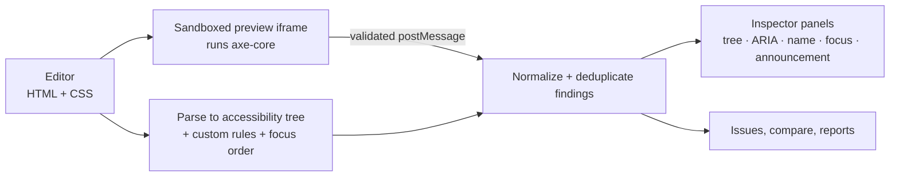

# Accessibility Playground

An interactive tool for frontend engineers and QA professionals to learn, test and practice **WCAG 2.2** accessibility. Paste HTML and CSS into a live editor and see what assistive technology sees: the computed accessibility tree, ARIA state, accessible-name computation, focus order, a screen-reader announcement, and automated findings from `axe-core` plus custom rules. A learning centre, guided challenges and a colour contrast checker sit alongside it.

Everything runs in your browser. There are no accounts and no database, and your code never leaves the page.

---

## Features

| Feature                               | What it does                                                                                             |
| ------------------------------------- | -------------------------------------------------------------------------------------------------------- |
| **Live editor and preview**           | CodeMirror 6 editor (HTML and CSS) with accessibility-aware completions and a sandboxed live preview     |
| **Accessibility tree and inspectors** | Computed tree, ARIA explorer, accessible-name trace, focus order, announcement text                      |
| **Automated findings**                | `axe-core` plus 16 custom rules, merged into one deduplicated list with WCAG references and fix guidance |
| **Baseline and compare**              | Save a baseline and see which issues are new, resolved or persisting                                     |
| **Manual tests**                      | Checklists for what automation cannot verify (keyboard, screen reader, visual)                           |
| **Challenges**                        | Guided "find and fix" exercises with automatic verification                                              |
| **Learning centre**                   | Topics with good and bad examples that open directly in the playground                                   |
| **Colour contrast checker**           | Standalone WCAG contrast calculator with a passing-colour suggestion                                     |
| **Export and share**                  | JSON, CSV and Markdown reports; shareable links                                                          |

---

## Tech stack

Next.js 16 (App Router) · React 19 · TypeScript (strict) · Tailwind CSS v4 · Accessly UI · CodeMirror 6 · `axe-core` (vendored in `public/axe.min.js`) · Zod · Vitest · Playwright

---

## How it works (high level)



1. **Parse.** Your HTML is parsed in the browser into an accessibility tree, and each element gets a stable `data-a11y-id` so the editor, preview and panels all point at the same node.
2. **Sandbox.** The preview runs in an iframe with `sandbox="allow-scripts"` and no `allow-same-origin`, so untrusted markup cannot touch cookies, storage or the app itself.
3. **Scan.** `axe-core` runs inside the sandbox from a local file. Results return by `postMessage`, and the app checks the sender and validates every message with Zod before using it.
4. **Combine.** Custom-rule findings and axe findings are merged into one list. If axe is unavailable, the app keeps showing the custom-rule findings and says clearly that the axe scan did not run.

For the full design, see [ARCHITECTURE.md](./ARCHITECTURE.md).

---

## Quick start

```bash
git clone https://github.com/antaripdebgupta/accessibility-playground.git
cd accessibility-playground
npm install
npm run dev
```

Open <http://localhost:3000>.

Commands, environment variables, the production build and the testing guide are in **[SETUP.md](./SETUP.md)**.

---

## Accessibility commitments

This app aims to meet WCAG 2.2 AA on every route:

- **Keyboard operable.** Every action is reachable by keyboard; F6 / Shift+F6 switch panes and Ctrl/Cmd+Enter rescans. The code editor documents how to leave it (Esc, then Tab).
- **Visible focus.** All interactive controls show a clear `:focus-visible` indicator.
- **Skip links.** A skip link is the first focusable element.
- **Not colour alone.** Status, severity and pass/fail always pair colour with an icon and text.
- **Target size.** Interactive controls meet the 24 × 24 CSS px minimum.
- **Reduced motion.** Animations and smooth scrolling respect `prefers-reduced-motion`.
- **Reflow.** Layouts work at 320 CSS px and at 400 % zoom, apart from the code editor and preview, which need two-dimensional scrolling.

Automated tools find only part of the WCAG issues. Passing a scan does not mean a page is accessible; please also test with a keyboard, a screen reader and zoom.

---

## Documentation

- [SETUP.md](./SETUP.md): installation, commands, environment variables, build and the testing guide
- [ARCHITECTURE.md](./ARCHITECTURE.md): high-level design of the playground and the contrast checker
